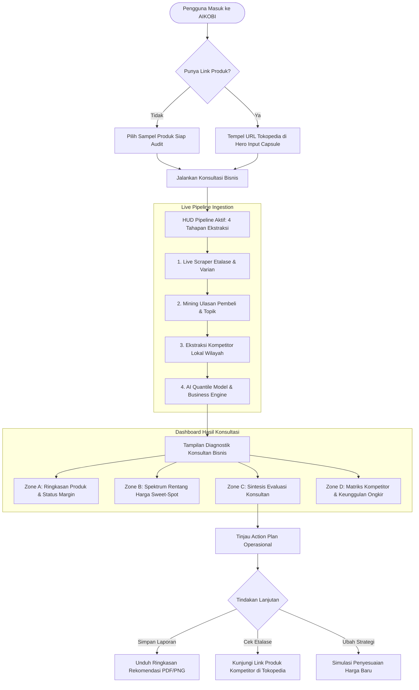
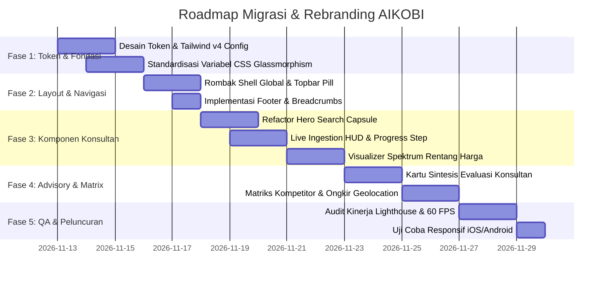

# Panduan Desain Sistem, UI/UX, & Rebranding: AIKOBI (Akal Imitasi Konsultan Bisnis)

Dokumen ini merupakan cetak biru desain (*design blueprint*), spesifikasi arsitektur antarmuka, dan panduan migrasi teknis komprehensif untuk mentransformasikan platform **AIMA (AI Market Analyzer)** menjadi **AIKOBI (Akal Imitasi Konsultan Bisnis)**.

---

## 1. Identitas Brand & Filosofi Rebranding: Dari AIMA ke AIKOBI

### 1.1 Latar Belakang & Alasan Rebranding
Proyek sebelumnya (*AIMA - AI Market Analyzer*) berfokus pada persepsi fungsional sebagai alat *scraping* dan pembanding harga (*price optimizer*). Namun, nilai riil yang paling dibutuhkan oleh pelaku UMKM dan merchant online bukan sekadar data mentah atau angka prediksi harga, melainkan **pendampingan strategis layaknya konsultan bisnis profesional** yang mampu menjelaskan *mengapa* produk kompetitor lebih laku, *bagaimana* celah ulasan pembeli dapat dimanfaatkan, dan *apa* langkah aksi konkret untuk meningkatkan omzet serta margin keuntungan.

Oleh karena itu, platform ini berevolusi dan melakukan *rebranding* total menjadi:

> **AIKOBI**  
> *(Akal Imitasi Konsultan Bisnis)*  
> *"Mitra Strategis AI Cerdas, Taktis, dan Terpercaya untuk Kemenangan Produk Anda di Pasar Digital."*

### 1.2 Pilar Nilai Utama AIKOBI (The Strategic Triad)
1. **Intelligent Market Sensing (Sensor Pasar Real-Time)**:
   Mengekstrak bukan hanya harga, melainkan konteks listing: varian multi-ukuran, rating, volume ulasan, topik kepuasan/kekecewaan pembeli, dan lokasi toko asal (*origin shipping location*) untuk keunggulan ongkir lokal.
2. **Explainable Pricing & Margin Architecture (Arsitektur Harga Transparan)**:
   Menghindari *black-box* AI. Prediksi harga menggunakan estimasi rentang berbasis *Quantile Regression* yang dipadukan dengan aturan deterministik status harga (*Underpriced*, *Sweet-Spot*, *Overpriced*) sehingga rekomendasi dapat diaudit dan dipercaya secara rasional.
3. **Actionable Strategic Advisory (Sintesis Konsultasi Taktis)**:
   Mengubah data metrik menjadi *executive summary*: dekonstruksi faktor kesenjangan harga (grade material, reputasi toko, paket bundling), pemetaan sentimen pembeli, serta rencana tindakan operasional toko (*Operational Action Plan*).

### 1.3 Karakter & Nada Suara (Voice & Tone)
* **Taktis & Objektif**: Menggunakan angka dan rasio komparatif yang konkret, tanpa klaim bombastis yang menyesatkan.
* **Empatik terhadap UMKM**: Memahami dilema pedagang (misal: dilema perang harga, kendala margin tipis, biaya logistik antarpulau).
* **Solutif & Berdaya Aksi**: Setiap temuan kelemahan pasar selalu diimbangi dengan solusi taktis yang bisa dieksekusi hari ini.
* **Modern & Tidak Kaku**: Menggunakan bahasa Indonesia profesional yang segar, lugas, dan terbebas dari jargon kecerdasan buatan yang membingungkan.

### 1.4 Konstruksi Logo, Proporsi, & Standar Identitas Visual
Mengacu pada spesifikasi resmi **Brand Guidelines AIKOBI**, identitas visual dan logo utama diatur dengan pedoman presisi sebagai berikut:

* **Anatomi Simbol**:
  Logo utama terdiri atas monogram geometris huruf **"A"** yang dibentuk oleh simpul kecerdasan buatan (*neural nodes*) dan panah pertumbuhan diagonal ke kanan atas, dipadukan dengan *wordmark* kapital **AIKOBI** bergaya sans-serif geometris tebal.
* **Rasio Proporsi Lockup**:
  * Tinggi huruf kapital **AIKOBI** berada di kisaran 55%–60% dari total tinggi ikon "A" (diukur dari dasar kaki hingga ujung atas panah).
  * Jarak horizontal antara sisi terkanan panah ikon dan huruf "A" pertama sebesar **1× ketebalan batang (*stroke width*) huruf "I"**.
* **Tiga Konfigurasi Utama Logo**:
  1. **Primary Horizontal Lockup**: Kombinasi simbol "A" dan teks **AIKOBI** untuk dokumen resmi, dek presentasi, faktur, dan area utama halaman web.
  2. **Horizontal Compact**: Dioptimalkan khusus untuk *Dynamic Navbar / Topbar* aplikasi web dengan tinggi proporsional **36 px – 40 px**.
  3. **Standalone Mark / App Icon**: Simbol huruf "A" tunggal tanpa teks untuk *favicon* web, avatar media sosial, stempel 1-warna, dan ikon aplikasi seluler.
* **Area Aman (*Clear Space*)**:
  * Sisakan ruang kosong di keempat sisi logo minimal sebesar **$1X$**, di mana **$X$** setara dengan tinggi huruf **"I"** pada *wordmark* **AIKOBI**.
  * Untuk penggunaan *Standalone Mark*, sisakan margin aman minimal **20% dari lebar ikon** di setiap sisi.
* **Ukuran Minimum Keterbacaan**:
  * *Horizontal Lockup*: Lebar minimum **120 px** untuk media digital atau **30 mm** untuk media cetak agar teks **AIKOBI** tetap terbaca jelas.
  * *Horizontal Compact (*Navbar*)*: Tinggi minimum **36 px**.
  * *Standalone Mark (*Favicon*)*: Ukuran minimum **16×16 px** dan **32×32 px** dengan tetap mempertahankan kejelasan titik simpul dan ujung panah.
* **Larangan Penggunaan Logo (*Brand Don'ts*)**:
  * Dilarang mengubah proporsi, memiringkan (*skewing*), atau memisahkan sudut panah dari jaringan simpul huruf "A".
  * Dilarang menambahkan efek bayangan (*drop shadow*), tekstur 3D berlebih, atau menggabungkan simbol keranjang belanja dan ikon diskon klise ke dalam logo.
  * Dilarang menempatkan logo penuh warna di atas latar berwarna cerah yang menurunkan kontras biru kobalt dan hijau zamrud.

---

## 2. Paradigma Desain: Kombinasi Modern Flat x Liquid Glassmorphism

Tantangan utama antarmuka berbasis web modern adalah dilema antara **estetika visual** dan **performa perangkat**.
* *Pure Glassmorphism* (kaca tebal di mana-mana) sering menghasilkan penurunan frame rate (GPU throttling), teks sulit dibaca (*poor contrast*), dan konsumsi daya baterai tinggi pada perangkat mobile atau laptop spesifikasi standar UMKM.
* *Pure Flat* (desain serba datar standar) seringkali terasa hambar, steril, kaku (*rigid*), dan gagal merefleksikan kecanggihan platform berbasis AI mutakhir.

**Solusi AIKOBI**: Menerapkan paradigma **Modern Flat Foundation dengan Liquid Glassmorphism Accents (Formula 80/20)**.

```
┌────────────────────────────────────────────────────────────────────────┐
│                        PARADIGMA DESAIN AIKOBI                         │
│                                                                        │
│   ┌──────────────────────────────────┐ ┌───────────────────────────┐   │
│   │   80% MODERN FLAT FOUNDATION     │ │ 20% LIQUID GLASS ACCENTS  │   │
│   │                                  │ │                           │   │
│   │ • Solid High-Contrast Background │ │ • Floating Dynamic Nav    │   │
│   │ • Crisp Typographic Hierarchy    │ │ • Hero Search Capsule     │   │
│   │ • Stable Grid & Negative Space   │ │ • Sweet-Spot Price Slider │   │
│   │ • Zero GPU Layer Paint Thrash    │ │ • Live Pipeline HUD       │   │
│   │ • Instant DOM Paint & Low Latency│ │ • Refraction Rim Borders  │   │
│   └──────────────────────────────────┘ └───────────────────────────┘   │
└────────────────────────────────────────────────────────────────────────┘
```

### 2.1 Ciri Khas "Modern Flat" pada AIKOBI
* **Kanvas Solid Berkontras Tinggi**: Latar belakang aplikasi menggunakan warna kanvas netral solid (`#0B0F17` pada Dark Mode / `#F8FAFC` pada Light Mode) sehingga teks utama memiliki rasio kontras prima (> 10:1).
* **Struktur Grid Terbuka**: Menghindari kotak-kotak (*card nesting*) berlebihan. Pemisahan kelompok data dilakukan melalui garis pemisah tipis (*hairline divider*) dan *spatial rhythm* (ruang negatif), bukan bertumpuk kartu di dalam kartu.
* **Tipografi Tajam & Data Tabular**: Semua angka metrik finansial, persentase margin, dan harga Rupiah menggunakan font monospace berformat angka tabular untuk kemudahan scanning mata secara presisi.

### 2.2 Ciri Khas "Liquid Glassmorphism" pada AIKOBI
* **Refraction Edge Light (Ilusi Pembiasan Tepi Kaca)**:
  Bukan sekadar blur kabur, melainkan simulasi ketebalan kaca cair melalui *hairline border* semi-transparan `1px solid rgba(255, 255, 255, 0.12)` dan *inner specular highlight* `box-shadow: inset 0 1px 0 rgba(255, 255, 255, 0.15)`.
* **Subtle Frosted Depth**:
  Tingkat blur dibatasi secara efisien pada rentang `10px` hingga `14px`, hanya diaplikasikan pada permukaan yang melayang (*floating layers*: Topbar, Hero Input Bar, Sweet-Spot Range Handle, Modal Popovers).
* **Squircle Curvature (Kelengkungan Organik)**:
  Menghilangkan sudut tajam kaku dengan radius melengkung alami (*squircle radius* dari `14px` hingga `28px`) sehingga panel tampak seperti tetesan cairan yang tertata rapi.
* **Fluid Spring Physics**:
  Micro-interaction menggunakan kurva pegas alami `cubic-bezier(0.16, 1, 0.3, 1)` dengan tactile compression (`scale-[0.98]` saat ditekan) sehingga interaksi terasa kenyal, hidup, dan tidak kaku.

---

## 3. Arsitektur Informasi & UI/UX Flow

### 3.1 Peta Situs (Information Architecture)
1. `/` — **Beranda (Showcase & Quick Audit)**:
   Perkenalan AIKOBI, demonstrasi interaktif perbandingan harga, dan pintu masuk cepat (*instant URL submission*).
2. `/konsultasi` (sebelumnya `/ai`) — **Ruang Konsultasi Bisnis AI**:
   Pusat analisis utama: input link produk Tokopedia/Shopee, visualisasi live pipeline data, visualizer spektrum harga wajar, kartu sintesis konsultan, evaluasi ulasan, dan matriks kompetitor lokal.
3. `/pasar` (sebelumnya `/dashboard`) — **Radar Dinamika Pasar UMKM**:
   Monitoring agregat tren harga, kategori terlaris, sebaran lokasi seller, dan filter produk serupa.
4. `/insight` — **Kecerdasan Kategori & Wilayah**:
   Grafik perbandingan harga rata-rata antar kota logistik dan tren pergeseran preferensi konsumen.
5. `/tentang` — **Transparansi Metodologi & Filosofi**:
   Penjelasan cara kerja model AI (Quantile Regression + Explainable Rules) serta jaminan privasi data merchant.

### 3.2 Diagram Alur Pengalaman Pengguna (User Flow)



### 3.3 Lima Siklus Status Antarmuka (UX State Machine)

| Siklus Status | Karakteristik Visual & Perilaku | Panduan Feedback Interaksi |
| :--- | :--- | :--- |
| **1. Idle / Initial State** | Kanvas bersih, Hero input capsule berada di posisi fokus dengan aksen border menyala lembut (*subtle rim*). Di bawahnya terdapat pill sampel link produk yang dapat diklik langsung. | Memberikan kesan ramah, tanpa distraksi visual berat. Placeholder formulir memberikan instruksi yang jelas. |
| **2. Progressive Ingestion State** | Formulir input bertransformasi menjadi *Live Pipeline HUD*. Progress bar cair dinamis dengan penanda tahapan (25%, 50%, 75%, 100%) dan teks status yang selalu diperbarui. | Mengeliminasi kebingungan pengguna saat scraping memakan waktu 2–5 detik. Status detail mencegah pengguna melakukan refresh halaman. |
| **3. Active Diagnostic State** | Data langsung ter-render dengan efek stagger fade-in (`150ms`). Zona harga sweet-spot tampil pertama sebagai *anchor insight*, diikuti kartu ulasan dan daftar kompetitor. | Struktur asimetris memudahkan mata melihat rekomendasi inti dalam waktu kurang dari 3 detik. |
| **4. Resilient Error State** | Jika URL salah, produk 404, atau scraping dibatasi, tampilkan Liquid Alert Capsule berwarna amber/merah dengan penjelas bahasa manusia dan tombol alternatif langsung ("Coba link lain" / "Gunakan sampel demo"). | Larangan: Jangan menampilkan kode error stack trace teknis (misal: `Error 500: AxiosTimeout`). Selalu tawarkan solusi instan. |
| **5. Action / Export State** | Panel mengambang di pojok kanan bawah (*Floating Action Bar*) memberikan opsi ekspor ringkasan strategi ke format gambar atau PDF satu lembar. | Tidak menutupi konten utama (*non-intrusive*), muncul otomatis setelah pengguna selesai membaca analisis. |

---

## 4. Sistem Desain & Spesifikasi Token (Design Tokens)

Sistem token AIKOBI dikonfigurasi untuk kompatibilitas penuh dengan **Tailwind CSS v4** dan variabel CSS native.

### 4.1 Palet Warna Semantik & Spesifikasi Warna Resmi

Sesuai dengan **Brand Guidelines AIKOBI**, palet warna dirancang agar harmonis pada antarmuka mode terang (*Clean Alabaster*) maupun mode gelap (*Deep Space Obsidian*), serta mendukung cetak monokrom 1-warna.

#### A. Tabel Spesifikasi Palet Warna Resmi
| Peran Warna | Nama Warna | HEX | RGB | CMYK | Fungsi Penggunaan |
| :--- | :--- | :--- | :--- | :--- | :--- |
| **Warna Utama** | Royal Indigo / Cobalt Blue | `#2563EB` (`#1D4ED8`) | `37, 99, 235` (`29, 78, 216`) | `84, 58, 0, 8` (`87, 64, 0, 15`) | Simpul neural huruf "A", identitas teknologi AI, dan elemen utama merek. |
| **Aksen Pertumbuhan** | Emerald Green | `#059669` | `5, 150, 105` | `97, 0, 30, 41` | Panah kenaikan dan simpul puncak yang melambangkan profitabilitas serta zona harga *sweet-spot*. |
| **Aksen Taktis** *(opsional)* | Terracotta / Amber Warm | `#EA580C` / `#D97706` | `234, 88, 12` / `217, 119, 6` | `0, 62, 95, 8` / `0, 45, 97, 15` | Penanda peluang pasar lokal, *geolocation*, dan indikator notifikasi taktis pada UI. |
| **Kontras Gelap & Monokrom Hitam** | Slate Black (*Obsidian*) | `#0B0F17` | `11, 15, 23` | `52, 35, 0, 91` *(atau `100% K` untuk cetak)* | Teks **AIKOBI** pada latar terang, kanvas mode gelap, serta versi monokrom hitam pekat. |
| **Kontras Terang & Monokrom Putih** | Pure White | `#FFFFFF` | `255, 255, 255` | `0, 0, 0, 0` | Latar kanvas terang serta versi monokrom putih bersih di atas permukaan gelap. |

#### B. Kanvas Netral & Permukaan Solid (Modern Flat Core)
```css
:root {
  /* LIGHT MODE (Clean Alabaster Canvas) */
  --aikobi-bg: #F8FAFC;              /* Latar utama lembut ramah mata */
  --aikobi-surface: #FFFFFF;         /* Permukaan datar panel data */
  --aikobi-surface-subtle: #F1F5F9;  /* Kontras ringan untuk header tabel */
  --aikobi-border: #E2E8F0;          /* Border datar minimalis */
  --aikobi-border-hover: #CBD5E1;    /* Hover state untuk elemen interaktif */
  
  --aikobi-text-primary: #0F172A;    /* Slate-900: Kontras maksimal */
  --aikobi-text-secondary: #475569;  /* Slate-600: Teks penjelasan */
  --aikobi-text-tertiary: #94A3B8;   /* Slate-400: Label & hint kecil */
}

@media (prefers-color-scheme: dark), [data-theme="dark"] {
  :root {
    /* DARK MODE (Deep Obsidian Canvas) */
    --aikobi-bg: #0B0F17;              /* Deep Space Velvet */
    --aikobi-surface: #111827;         /* Gray-900 solid surface */
    --aikobi-surface-subtle: #1F2937;  /* Gray-800 divider */
    --aikobi-border: #1E293B;          /* Border flat gelap */
    --aikobi-border-hover: #334155;    /* Slate-700 hover */
    
    --aikobi-text-primary: #F8FAFC;    /* Putih tajam */
    --aikobi-text-secondary: #94A3B8;  /* Abu-abu terang */
    --aikobi-text-tertiary: #64748B;   /* Abu-abu redup */
  }
}
```

#### C. Warna Brand & Aksen Bisnis Antarmuka
* **AIKOBI Royal Indigo (Aksen Brand Utama)**:
  * Primary: `#2563EB` (Cobalt Royal) | RGB `37, 99, 235` | CMYK `84, 58, 0, 8`
  * Hover / Deep: `#1D4ED8` | RGB `29, 78, 216` | CMYK `87, 64, 0, 15`
  * Glow Ring: `rgba(37, 99, 235, 0.25)`
  * Makna & Fungsi: Simpul neural huruf "A", identitas teknologi AI, dan elemen penegasan utama merek.
* **Sweet-Spot / Zona Profit Wajar (Emerald Green Pertumbuhan)**:
  * Solid: `#059669` (Emerald 600) | RGB `5, 150, 105` | CMYK `97, 0, 30, 41`
  * Surface Tint: `#ECFDF5` (Emerald Light) / `rgba(5, 150, 105, 0.12)` (Dark)
  * Makna & Fungsi: Panah kenaikan dan simpul puncak, melambangkan profitabilitas dan harga berada di titik ideal permintaan pasar.
* **Underpriced / Peringatan Margin Rendah (Amber Warm Taktis)**:
  * Solid: `#D97706` (Amber 600) | RGB `217, 119, 6` | CMYK `0, 45, 97, 15`
  * Surface Tint: `#FFFBEB` (Amber Light) / `rgba(217, 119, 6, 0.12)` (Dark)
  * Makna & Fungsi: Indikator notifikasi taktis; harga terlalu murah berisiko merusak margin keuntungan toko.
* **Overpriced / Risiko Penjualan Mandek (Merah Koral Presisi)**:
  * Solid: `#E11D48` (Rose 600)
  * Surface Tint: `#FFF1F2` (Rose Light) / `rgba(225, 29, 72, 0.12)` (Dark)
  * Makna & Fungsi: Harga di atas penerimaan pasar, kemungkinan kalah saing kecuali ada diferensiasi nyata.
* **Keunggulan Kurir Lokal / Geolocation Advantage (Terracotta Taktis)**:
  * Solid: `#EA580C` (Orange 600) | RGB `234, 88, 12` | CMYK `0, 62, 95, 8`
  * Surface Tint: `#FFEDD5` (Orange Light) / `rgba(234, 88, 12, 0.15)` (Dark)
  * Makna & Fungsi: Penanda peluang pasar lokal dan kompetitor sesama wilayah pengiriman untuk efisiensi ongkos kirim.

#### D. Spesifikasi Token "Liquid Glass"
```css
/* LEVEL 1: Floating Navigation & Header Capsule */
--aikobi-glass-nav-bg: rgba(255, 255, 255, 0.82);
--aikobi-glass-nav-border: rgba(226, 232, 240, 0.8);
--aikobi-glass-nav-blur: blur(12px);
--aikobi-glass-nav-shadow: 0 4px 20px -4px rgba(15, 23, 42, 0.06);

/* LEVEL 2: Dynamic Hero Search Capsule */
--aikobi-glass-hero-bg: rgba(255, 255, 255, 0.9);
--aikobi-glass-hero-border: rgba(37, 99, 235, 0.2);
--aikobi-glass-hero-inner-glow: inset 0 1px 1px rgba(255, 255, 255, 0.9);
--aikobi-glass-hero-shadow: 0 8px 30px -6px rgba(37, 99, 235, 0.12);

/* LEVEL 3: Sweet-Spot Visualizer & Floating Modals */
--aikobi-glass-modal-bg: rgba(255, 255, 255, 0.88);
--aikobi-glass-modal-border: rgba(255, 255, 255, 0.6);
--aikobi-glass-modal-blur: blur(14px);

/* DARK MODE OVERRIDES UNTUK LIQUID GLASS */
[data-theme="dark"] {
  --aikobi-glass-nav-bg: rgba(17, 24, 39, 0.75);
  --aikobi-glass-nav-border: rgba(255, 255, 255, 0.1);
  --aikobi-glass-nav-shadow: 0 4px 24px -2px rgba(0, 0, 0, 0.4);

  --aikobi-glass-hero-bg: rgba(17, 24, 39, 0.85);
  --aikobi-glass-hero-border: rgba(96, 165, 250, 0.25);
  --aikobi-glass-hero-inner-glow: inset 0 1px 0 rgba(255, 255, 255, 0.15);
  --aikobi-glass-hero-shadow: 0 8px 32px -4px rgba(0, 0, 0, 0.6);

  --aikobi-glass-modal-bg: rgba(17, 24, 39, 0.88);
  --aikobi-glass-modal-border: rgba(255, 255, 255, 0.12);
  --aikobi-glass-modal-blur: blur(16px);
}
```

### 4.2 Rekomendasi Pasangan Tipografi Resmi (Font Pairing)

Mengikuti pedoman resmi **Brand Guidelines AIKOBI**, hierarki tipografi distandarisasi untuk menjamin keseimbangan estetika modern, kejelasan informasi, dan kenyamanan membaca bagi pelaku UMKM:

| Peran Tipografi | Pilihan Font Family | Bobot & Ukuran | Karakter & Panduan Penggunaan |
| :--- | :--- | :--- | :--- |
| **Tipografi Judul (Heading / Display)** | **Plus Jakarta Sans** | Bold (700) / SemiBold (600), `text-3xl` s/d `text-5xl` (`tracking-tight`) | Selaras dengan karakter geometris modern *wordmark* **AIKOBI**, memancarkan otoritas percaya diri, dan mudah dibaca oleh pelaku UMKM. |
| **Subheading & Seksi** | **Plus Jakarta Sans** | SemiBold (600) / Bold (700), `text-base` s/d `text-xl` | Menstruktur hierarki data dan navigasi dashboard secara teratur dan lugas. |
| **Tipografi Isi & Antarmuka (Body / UI Copy)** | **Inter** | Regular (400) / Medium (500), `text-xs` s/d `text-base` (`leading-relaxed`) | Menjaga kejelasan informasi (*legibility*) pada tabel riset kompetitor, ringkasan ulasan pembeli, dan rekomendasi taktis di layar kecil. |
| **Tipografi Angka & Metrik Harga** | **Inter** *(Tabular Figures `tnum`)* atau **JetBrains Mono** | Medium (500) / Bold (700), `tabular-nums` | Wajib mengaktifkan fitur *Tabular Figures* (`tnum`) pada **Inter** atau menggunakan **JetBrains Mono** untuk kolom harga *sweet-spot*, persentase margin, dan delta harga agar deretan angka sejajar vertikal. |

### 4.3 Kelengkungan Organik (Squircle Radius) & Spacing
* `radius-sm: 8px` — Tag status, badge wilayah, dan chip kategori kecil.
* `radius-md: 14px` — Input form, tombol sekunder, dan kartu produk kompetitor.
* `radius-lg: 20px` — Panel analisis konsultan utama, box grafik perbandingan.
* `radius-xl: 28px` — Hero input bar kapsul melayang (*floating search capsule*).
* `radius-pill: 9999px` — Dynamic island navbar, badge penanda status, dan pill switch.
* **Sistem Spacing**: Mengikuti kelipatan 4px/8px (`gap-2: 8px`, `gap-4: 16px`, `gap-6: 24px`, `gap-8: 32px`). Container utama dibatasi maksimal `1320px` dengan auto-padding samping responsif (`px-4 sm:px-6 lg:px-8`).

---

## 5. Spesifikasi Komponen Antarmuka (Component Library)

```
┌────────────────────────────────────────────────────────────────────────┐
│               ANATOMI ANTARMUKA RUANG KONSULTASI AIKOBI                │
├────────────────────────────────────────────────────────────────────────┤
│ [AIKOBI LOGO]    [Beranda]  [Konsultasi AI (Aktif)]  [Pasar]    (● Online)│ <- 5.1 Nav
├────────────────────────────────────────────────────────────────────────┤
│                                                                        │
│   AKAL IMITASI KONSULTAN BISNIS                                        │
│   Diagnostik Strategi Harga & Etalase Marketplace Real-Time            │
│                                                                        │
│  ┌─────────────────────────────────────────────────────────┬─────────┐ │
│  │ 🔍 https://www.tokopedia.com/toko/produk-kemeja-batik   │ KONSUL  │ │ <- 5.2 Input
│  └─────────────────────────────────────────────────────────┴─────────┘ │
│    Sampel Cepat: [Kemeja Batik Katun] [TWS Bluetooth] [Kopi Arabika]   │
│                                                                        │
├────────────────────────────────────────────────────────────────────────┤
│  ● Menghubungkan Scraper  ➔  ● Ekstraksi Varian  ➔  ● Model Regresi    │ <- 5.3 HUD
├────────────────────────────────────────────────────────────────────────┤
│  ┌─────────────────────────┐  ┌─────────────────────────────────────┐  │
│  │ KARTU IDENTITAS PRODUK  │  │ SPEKTRUM HARGA SWEET-SPOT (DEMAND)  │  │ <- 5.4 Visualizer
│  │ Kemeja Batik Solo Premium│  │                                     │  │
│  │ Harga Toko: Rp 120.000  │  │  Min: 85rb   [ZONA WAJAR]   Max: 160rb│
│  │ Status: [SWEET-SPOT]     │  │  ═══════●════════[▲]═════════════●═ │  │
│  └─────────────────────────┘  └─────────────────────────────────────┘  │
├────────────────────────────────────────────────────────────────────────┤
│  ┌─────────────────────────────────┐ ┌───────────────────────────────┐ │
│  │ 💡 SINTESIS EVALUASI KONSULTAN   │ │ 🚚 KEUNGGULAN ONGKIR LOKAL    │ │ <- 5.5 & 5.6
│  │ • Poin Keunggulan Ulasan        │ │ • 3 Toko Sekitar Kota Solo    │ │
│  │ • Potensi Kenaikan Margin       │ │ • Keunggulan Pengiriman Cepat │ │
│  │ • Action Plan 30 Hari           │ │ • Tautan Etalase Tokopedia    │ │
│  └─────────────────────────────────┘ └───────────────────────────────┘ │
└────────────────────────────────────────────────────────────────────────┘
```

### 5.1 Dynamic Brand Topbar & Floating Navigation
* **Fungsi**: Memposisikan identitas AIKOBI dan navigasi global secara melayang di bagian atas halaman dengan efek kaca cair.
* **Spesifikasi CSS**:
  ```css
  .aikobi-topbar {
    position: sticky;
    top: 16px;
    z-index: 50;
    margin: 0 auto;
    max-width: 1280px;
    height: 64px;
    padding: 0 24px;
    display: flex;
    align-items: center;
    justify-content: space-between;
    border-radius: 9999px;
    background: var(--aikobi-glass-nav-bg);
    backdrop-filter: var(--aikobi-glass-nav-blur);
    border: 1px solid var(--aikobi-glass-nav-border);
    box-shadow: var(--aikobi-glass-nav-shadow);
    transition: transform 0.25s cubic-bezier(0.16, 1, 0.3, 1);
  }
  ```
* **Elemen Internal**:
  * **Brand Mark (Horizontal Compact Lockup)**:
    * Menggunakan konfigurasi **Horizontal Compact** sesuai Brand Guidelines dengan tinggi proporsional **36 px – 40 px** (`w-9 h-9` hingga `w-10 h-10`, tinggi minimum 36 px).
    * Simbol: Monogram geometris huruf **"A"** (simpul kecerdasan buatan dan panah pertumbuhan diagonal ke kanan atas) bergradien Royal Indigo ke Cobalt Blue (`#2563EB` s/d `#1D4ED8`), dipadukan dengan *wordmark* kapital **AIKOBI** dan sub-label *"Konsultan Bisnis"*.
    * Area aman (*clear space*): Mempertahankan ruang kosong minimal **$1X$** (setara tinggi huruf "I" pada kata AIKOBI).
  * **Nav Links Capsule**: Menu aktif memiliki *pill background* berwarna solid netral dengan teks kontras tinggi, berpindah menggunakan transisi halus.
  * **Engine Live Indicator**: Titik hijau berkedip lembut (*live pulsating beacon*) dengan teks "Tokopedia Sensor Ready" yang memberikan jaminan keandalan operasional scraper secara real-time.

### 5.2 AI Consultant Hero Input Bar (Pill Capsule)
* **Fungsi**: Titik interaksi pertama pengguna untuk memasukkan URL produk Tokopedia.
* **Spesifikasi Interaksi**:
  * Input bar didesain memanjang dengan kelengkungan penuh (*squircle pill* `rounded-full` atau `rounded-2xl`).
  * Saat field aktif (*focus state*): Border bertransformasi memancarkan pendaran biru royal halus (`box-shadow: 0 0 0 3px rgba(37, 99, 235, 0.2)`), tanpa layout shift.
  * **Tombol Aksi**: Tombol "Mulai Konsultasi" berada terintegrasi di dalam kapsul di sebelah kanan. Dilengkapi ikon panah/sparkle dari Lucide Icons (`Sparkles` atau `ArrowRight`).
  * **Micro-interactions**: Efek tactile compression saat tombol ditekan (`active:scale-[0.98]`).
  * **Contextual Sample Pills**: Di bawah input form, sediakan 3 tautan sampel produk realistis (*Batik Solo*, *TWS Earphone*, *Kopi Gayo*) yang jika diklik langsung mengisi input dan menjalankan analisis otomatis.

### 5.3 Live Pipeline Progress HUD
* **Fungsi**: Menghilangkan kekosongan saat menunggu proses scraping dan komputasi data (biasanya berlangsung 2–4 detik).
* **Tahapan Pipeline**:
  1. `25%` — Menghubungkan ke Tokopedia Live Engine & Parsing Metadata Etalase.
  2. `50%` — Menambang Varian Produk & Distribusi Harga Kompetitor.
  3. `75%` — Mengekstrak Topik Ulasan Pembeli & Klaster Wilayah Pengiriman.
  4. `100%` — Model Kuantil Selesai: Menyusun Sintesis Strategi Konsultan AIKOBI.
* **Detail Visual**: Bar indikator cair (*liquid progress track*) dengan kilauan cahaya putih tipis (*shimmer effect*) yang mengalir ke kanan menggunakan animasi `transform: translateX()`.

### 5.4 Liquid Fair Price "Sweet-Spot" Range Spectrum
* **Fungsi**: Visualisasi grafis inti yang memetakan posisi harga toko pengguna terhadap dinamika pasar secara instan.
* **Komponen Grafis**:
  * **Spektrum Bar Horizontal**: Gradien halus dari Biru Netral (Harga Terendah Pasar), Hijau Zamrud (Zona Wajar Sweet-Spot), hingga Rose Coral (Harga Tertinggi Pasar).
  * **Marker 1: Harga Toko Anda**: Pin penanda vertikal dengan badge nominal di atasnya. Jika toko berada di zona hijau, badge menyala hijau. Jika terlalu murah/mahal, badge otomatis berganti warna sesuai status.
  * **Marker 2: Median Pasar (Kuantil 0.5)**: Garis putus-putus halus penanda titik tengah pasar.
  * **Rentang Zona Wajar**: Arsiran semi-transparan yang membentang dari batas bawah kuantil wajar ke batas atas kuantil wajar.
  * **Label Anti-Collision**: Logika kalkulasi posisi teks yang memastikan label "Harga Anda" dan "Rata-rata Pasar" tidak bertumpuk jika kedua nilai berdekatan secara nominal.

### 5.5 Executive Consultant Advisory Cards (Tata Letak Asimetris)
Alih-alih membuat 3 kartu berukuran sama yang monoton, AIKOBI membagi hasil konsultasi ke dalam tata letak asimetris yang memprioritaskan keputusan bisnis:

* **Kolom Kiri (60% Lebar) — Rekomendasi Strategi & Action Plan**:
  * Status Utama: Badge besar "Harga Sweet-Spot: Pertahankan Margin", "Underpriced: Naikkan Bertahap", atau "Overpriced: Re-bundling Diperlukan".
  * *Penyebab Perbedaan Harga*: Poin analitis terurai (misal: "Kompetitor menjual 18% lebih murah karena tidak menyertakan garansi resmi dan kemasan dus premium").
  * *Langkah Taktis 30 Hari*: 3 poin aksi langsung (misal: penyesuaian diskon coret, pembuatan paket bundling 2 pcs, penambahan kata kunci wilayah pada judul produk).
* **Kolom Kanan (40% Lebar) — Sentimen Ulasan Pembeli**:
  * *Hal yang Dipuji Pembeli*: Daftar poin hijau dengan kutipan ulasan (misal: "Kecepatan kirim", "Ketebalan bahan").
  * *Keluhan yang Harus Diantisipasi*: Daftar poin merah (misal: "Jahitan kancing longgar", "Respon chat lambat").

### 5.6 Competitor Geolocation & Courier Advantage Matrix
* **Fungsi**: Membantu merchant memanfaatkan keuntungan ongkir lokal melawan kompetitor nasional.
* **Fitur Utama**:
  * Menampilkan listing produk pesaing sejenis dengan tag kota pengiriman (*shipping origin*).
  * Menyoroti badge oranye khusus **"Kompetitor Wilayah Anda"** jika kota toko kompetitor sama dengan toko pengguna.
  * Menampilkan perbandingan ongkos kirim rata-rata pembeli lokal vs pengiriman antarpulau.
  * Dilengkapi tombol eksternal langsung menuju etalase Tokopedia bersangkutan untuk verifikasi manual (*direct Tokopedia link*).

---

## 6. Keputusan Desain Teknis & Rekayasa Performa

Untuk mewujudkan pengalaman antarmuka yang cepat (*fast-performance*) dan luwes (*fluid motion*), berikut keputusan arsitektur teknis yang wajib dipatuhi:

### 6.1 Spesifikasi Stack Teknologi
* **Framework**: Next.js 16 (App Router) dengan React 19 Server & Client Components.
* **CSS Engine**: Tailwind CSS v4 via `@tailwindcss/postcss`.
* **State Management**: Zustand untuk caching hasil konsultasi antar-halaman.
* **Grafik Metrik**: Recharts & SVG murni untuk diagram interaktif yang ringan.
* **Iconography**: `lucide-react` (standardisasi `strokeWidth: 1.75` di seluruh komponen).

### 6.2 Aturan Kinerja GPU 60 FPS (The 60 FPS GPU Budget)
1. **Aturan Mutlak: Zero Nested Backdrop Filters**:
   Browser web mengalami penurunan performa drastis jika sebuah elemen dengan `backdrop-filter: blur()` ditempatkan di dalam kontainer lain yang juga menggunakan `backdrop-filter`.
   *Solusi*: Latar belakang halaman dan kontainer grid harus selalu berstatus **Flat Opaque**. Efek glassmorphism hanya diaplikasikan pada elemen melayang tunggal (*isolated floating leaves*).
2. **Isolasi Layer Rendering**:
   Gunakan atribut CSS `transform: translateZ(0)` atau `contain: paint` pada komponen kaca melayang untuk memastikan browser merender elemen tersebut pada GPU compositing layer terpisah, mencegah re-paint seluruh halaman saat terjadi pergerakan kursor atau scroll.
3. **Hardware-Accelerated Animation Only**:
   Dilarang keras menganimasikan properti layout seperti `top`, `left`, `width`, `height`, atau `margin`. Semua transisi fluid dan micro-interaction wajib menggunakan `transform` (`scale`, `translate3d`) dan `opacity`.
4. **Fallback Tanpa Blur untuk Perangkat Hemat Daya / Non-GPU**:
   ```css
   /* Fallback otomatis jika browser tidak mendukung backdrop-filter */
   @supports not (backdrop-filter: blur(1px)) {
     .aikobi-glass-panel {
       background: #FFFFFF !important;
       border: 1px solid #E2E8F0 !important;
     }
     [data-theme="dark"] .aikobi-glass-panel {
       background: #111827 !important;
       border: 1px solid #1F2937 !important;
     }
   }
   ```
5. **Virtualisasi Rendering & Content-Visibility**:
   Untuk daftar kartu kompetitor yang berjumlah lebih dari 20 item, terapkan `content-visibility: auto; contain-intrinsic-size: 0 160px;` agar elemen di luar viewport tidak membebani memori render browser.

### 6.3 Stabilitas Viewport & Pencegahan Layout Shift (CLS = 0)
* **Larangan Penggunaan `h-screen`**:
  `h-screen` menyebabkan lonjakan visual (*layout jumping*) saat browser mobile (seperti iOS Safari atau Android Chrome) menyembunyikan atau memunculkan navigation bar saat di-scroll.
  *Solusi*: Gunakan selalu unit modern `min-h-[100dvh]`.
* **Skeleton Placeholder dengan Rasio Eksak**:
  Sebelum data scraping selesai diunduh, tampilkan layout skeleton dengan tinggi dan rasio aspek yang identik dengan kartu hasil diagnosa untuk menjamin skor Cumulative Layout Shift (CLS) tetap bernilai 0.

### 6.4 Aksesibilitas (WCAG 2.1 Level AA Compliance)
* **Rasio Kontras Teks**: Semua teks di atas permukaan semi-transparan harus memenuhi rasio kontras minimal `4.5:1` untuk teks normal dan `3:1` untuk teks besar (`text-xl` ke atas).
* **Indikator Bukan Hanya Warna**: Status harga (*Underpriced / Sweet-Spot / Overpriced*) tidak boleh hanya bergantung pada warna hijau/merah (untuk membantu pengguna buta warna). Wajib selalu disertai ikon indikator pembeda dan label teks eksplisit.
* **Dukungan `prefers-reduced-motion`**:
  ```css
  @media (prefers-reduced-motion: reduce) {
    *, *::before, *::after {
      animation-duration: 0.01ms !important;
      animation-iteration-count: 1 !important;
      transition-duration: 0.01ms !important;
      scroll-behavior: auto !important;
    }
  }
  ```
  Pengguna dengan preferensi pengurangan gerak tetap mendapatkan fungsionalitas penuh tanpa transisi melayang.

---

## 7. Panduan Langkah-demi-Langkah Migrasi & Rebranding (AIMA -> AIKOBI)

### 7.1 Tabel Pemetaan Istilah & Struktur Rebranding

| Aspek | Proyek Lama (AIMA) | Proyek Baru (AIKOBI) | Alasan & Dampak |
| :--- | :--- | :--- | :--- |
| **Nama Brand** | AIMA (AI Market Analyzer) | **AIKOBI (Akal Imitasi Konsultan Bisnis)** | Menegaskan persona sebagai asisten konsultan bisnis UMKM terpercaya. |
| **Domain Rute Utama** | `/ai` | `/konsultasi` | Istilah lebih fungsional dan berorientasi pada nilai solusi pengguna. |
| **Domain Rute Dashboard** | `/dashboard` | `/pasar` | Merefleksikan eksplorasi radar dinamika pasar Tokopedia. |
| **Judul Halaman (SEO)** | "AIMA \| AI Market Analyzer" | **"AIKOBI \| Akal Imitasi Konsultan Bisnis"** | Rebranding menyeluruh pada metadata browser & OpenGraph. |
| **Komponen Engine** | `tokopedia-analyzer.tsx` | `aikobi-consultant-suite.tsx` | Menyatukan scraper, visualizer sweet-spot, dan kartu advisory. |
| **Identitas Simbol / Logo** | Monogram "AI" acak | **Monogram "A" (Neural Nodes + Growth Arrow) + Wordmark AIKOBI** | Konstruksi presisi dengan rasio proporsi 55%–60%, clear space $1X$, dan varian Horizontal Compact (36–40 px). |
| **Skema Warna Resmi** | Dominan ijo-kuning tradisional | **Royal Indigo (#2563EB), Emerald Green (#059669), Terracotta (#EA580C) / Amber (#D97706), & Obsidian (#0B0F17)** | Standar warna resmi lengkap dengan profil RGB/CMYK untuk cetak & digital. |
| **Standar Tipografi** | Space Grotesk umum | **Plus Jakarta Sans (Heading) + Inter (Body/UI) + Inter tnum / JetBrains Mono (Metrik)** | Pasangan font resmi (*font pairing*) berstandar Brand Guidelines dengan angka tabular sejajar. |
| **Gaya Kartu** | Border tebal klasik & kaku | **Flat Foundation + Liquid Glass Refraction** | Estetika mutakhir yang fluid dan tidak kaku. |

### 7.2 Tahapan Eksekusi Migrasi (Roadmap Fase 1 s/d Fase 5)



#### Fase 1: Pembaruan Token Desain & Konfigurasi CSS (`globals.css`)
1. Bersihkan variabel warna lama yang tidak konsisten di `apps/web/app/globals.css`.
2. Masukkan definisi variabel semantik `--aikobi-*` untuk mode terang dan gelap.
3. Definisikan kelas utilitas Tailwind untuk `.liquid-glass-nav`, `.liquid-glass-hero`, dan `.flat-surface`.

#### Fase 2: Pembaruan Layout Shell & Topbar
1. Ubah komponen `Header` di `apps/web/app/layout.tsx` menjadi kapsul mengambang `aikobi-topbar`.
2. Perbarui logo brand dari `AIMA` menjadi `AIKOBI` dengan slogan *"Akal Imitasi Konsultan Bisnis"*.
3. Perbarui link navigasi: Beranda (`/`), Konsultasi AI (`/konsultasi`), Radar Pasar (`/pasar`), dan Tentang (`/tentang`).

#### Fase 3: Rekayasa Ulang Ruang Konsultasi (`/konsultasi`)
1. Buat rute baru `apps/web/app/konsultasi/page.tsx` (dengan redirect dari rute lama `/ai`).
2. Terapkan tata letak hero asimetris: input form kapsul di sisi kiri-tengah, didampingi ringkasan nilai AIKOBI.
3. Tambahkan tombol sampel cepat untuk mempermudah pengujian tanpa harus menyalin link dari luar.
4. Terapkan komponen *Live Pipeline HUD* untuk menampilkan proses ekstraksi data secara berjenjang.

#### Fase 4: Integrasi Sweet-Spot Visualizer & Kartu Advisory
1. Ganti grafik lama dengan spektrum rentang harga sweet-spot interaktif berbasis SVG/CSS.
2. Format ulang output data AI menjadi 3 kartu evaluasi terfokus:
   * Posisi Harga Toko vs Rata-Rata Pasar.
   * Ulasan Pembeli (Pujian vs Celah Komplain).
   * Rekomendasi Taktis & Action Plan 30 Hari.
3. Perbarui kartu produk kompetitor dengan badge lokasi wilayah pengiriman yang jelas.

#### Fase 5: Quality Assurance & Verifikasi Kinerja
1. **Lighthouse Audit**: Pastikan skor Performance >= 90, Accessibility >= 95, dan Best Practices = 100.
2. **GPU Layer Inspection**: Buka Chrome DevTools -> *More Tools* -> *Rendering* -> *Layer Borders*. Pastikan tidak terjadi *continuous repaint* saat halaman di-scroll.
3. **Cross-Device Testing**: Verifikasi bahwa teks tetap tajam dan terbaca jelas di layar Retina Mac, layar Windows beresolusi standar, serta ponsel pintar Android & iPhone.

---

## 8. Panduan Komunikasi & Micro-Copywriting AIKOBI

Untuk menanamkan persepsi konsultan bisnis yang cerdas dan solutif, gunakan panduan kata berikut di seluruh UI:

| Konteks Antarmuka | Frasa Hindari (Kesan Alat Kaku / Mentah) | Frasa AIKOBI (Kesan Konsultan Bisnis Taktis) |
| :--- | :--- | :--- |
| **Headline Hero** | "Alat Scraper Harga Tokopedia Otomatis" | **"Optimalkan Margin & Kuasai Pasar Tokopedia bersama AIKOBI"** |
| **Placeholder Form** | "Masukkan URL Tokopedia di sini..." | **"Tempel link produk Tokopedia untuk audit strategi harga..."** |
| **Proses Loading** | "Sedang scraping database..." | **"Menganalisis dinamika etalase & pola belanja pembeli..."** |
| **Status Mahal** | "Status: Mahal (Bahaya)" | **"Harga di Atas Konsensus Pasar (Evaluasi Diferensiasi)"** |
| **Status Wajar** | "Status: Wajar / Pas" | **"Zona Wajar Sweet-Spot (Margin & Daya Serap Optimal)"** |
| **Status Murah** | "Status: Murah" | **"Peluang Kenaikan Margin (Harga Terlalu Rendah)"** |
| **Pesan Kesalahan 404**| "Error 404: Scrape failed" | **"Produk tidak ditemukan atau etalase sedang diarsipkan oleh penjual. Silakan periksa kembali link produk Anda."** |

---

## 9. Ringkasan & Tindakan Selanjutnya

Dokumen ini menjadi standar acuan tunggal bagi tim pengembang (*frontend engineers*, *AI engineers*, dan *product designers*) selama proses perombakan UI dan migrasi sistem. Dengan memadukan **fondasi flat yang kokoh dan berkinerja tinggi** dengan **aksen kaca cair (liquid glass) yang fleksibel dan estetis**, AIKOBI hadir sebagai platform konsultan bisnis digital generasi baru yang tidak hanya memikat secara visual, namun juga gesit, andal, dan mampu memberikan dampak bisnis nyata bagi pertumbuhan UMKM Indonesia.
