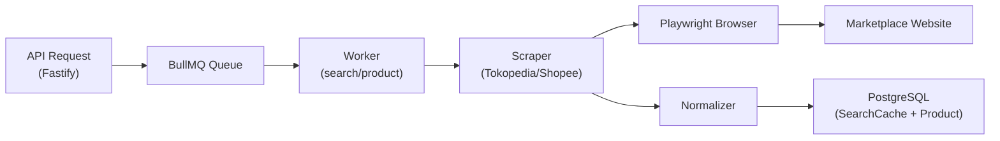
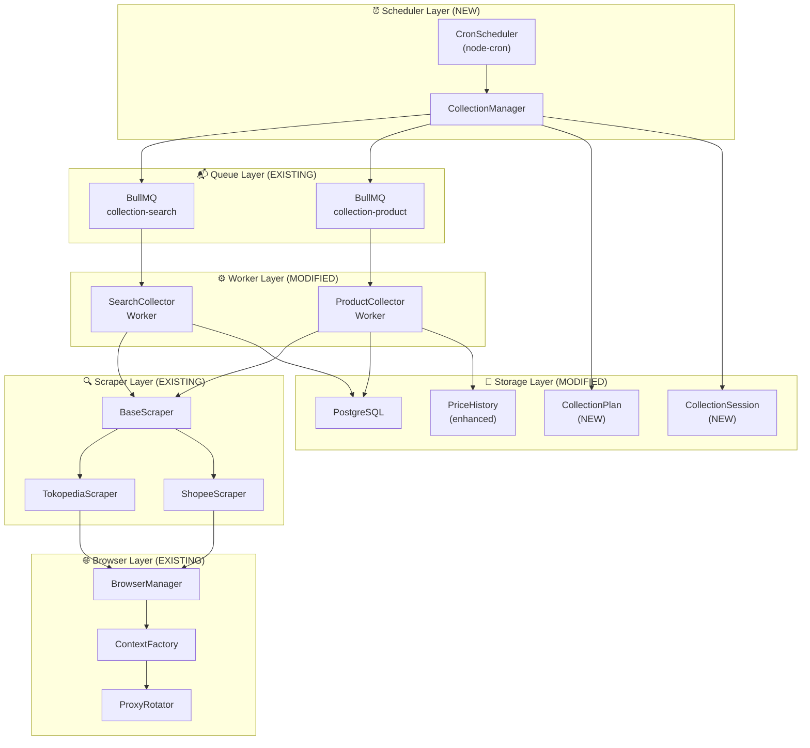

# Restrukturisasi Arsitektur Scraping Mechanism — Price Optimizer

> **Context**: Mengubah arsitektur scraping dari model BaaS (Backend-as-a-Service) menjadi komponen **Data Collection** untuk sistem **Price Optimizer** yang terintegrasi dengan AI untuk analisis tren harga.

---

## 📊 Analisis Kondisi Saat Ini (As-Is)

Arsitektur scraping yang sudah ada:



**Arsitektur saat ini (BaaS model)**:
- Scraping di-trigger oleh **user API request** (on-demand)
- Hasil disimpan ke `SearchCache` (TTL 24h) dan `Product` table
- Worker hanya jalan saat ada job dari API
- Data dikumpulkan **per-request**, bukan **periodik/bulk**
- Tidak ada mekanisme **scheduled scraping** untuk analisis tren

---

## 🎯 Arsitektur Baru (To-Be) — Price Optimizer Workflow

Berdasarkan gambar workflow yang diberikan, arsitektur baru fokus pada **Data Collection** yang:

1. **Scheduled & automated** — bukan lagi on-demand per user request
2. **Bulk collection** — scraping banyak produk/keyword secara periodik
3. **Trend-ready** — data terstruktur untuk analisis AI di tahap selanjutnya
4. **Price history tracking** — merekam perubahan harga secara berkala



---

## User Review Required

> [!IMPORTANT]
> **Perubahan arsitektur besar**: Mekanisme scraping berubah dari **on-demand** (user trigger) menjadi **scheduled + on-demand hybrid**. API yang sudah ada untuk on-demand scraping tetap dipertahankan, tapi ditambahkan layer baru untuk scheduled collection.

> [!WARNING]  
> **Database migration**: Akan ada penambahan tabel baru (`CollectionPlan`, `CollectionSession`, `CollectionLog`) dan modifikasi tabel `PriceHistory`. Pastikan backup database sebelum migration.

---

## Open Questions

> [!IMPORTANT]
> 1. **Marketplace target**: Dari gambar, hanya Tokopedia (Playwright) yang disebut. Apakah Shopee scraper yang sudah ada tetap dipertahankan, atau fokus Tokopedia dulu?
> 2. **Frekuensi scraping**: Berapa sering data harus dikumpulkan untuk AI trend analysis? (misal: setiap 6 jam, 12 jam, 24 jam?)
> 3. **Jumlah keyword/produk**: Berapa estimasi jumlah keyword yang akan di-track secara periodik? Ini mempengaruhi concurrency dan resource management.
> 4. **AI Integration point**: Apakah AI akan consume data dari database langsung, atau melalui API endpoint? Ini mempengaruhi bagaimana kita structure data output.

---

## Proposed Changes

### Component 1: Database Schema — New Tables & Modifications

Menambahkan tabel-tabel baru untuk mendukung scheduled collection dan tracking.

#### [MODIFY] [schema.prisma](file:///c:/Users/azkaw/Desktop/coding/vibe/Data-Scrapper/packages/db/prisma/schema.prisma)

Penambahan 3 model baru:

```prisma
// =====================================================
//  COLLECTION PLANS (Keyword/URL yang di-track periodik)
// =====================================================

model CollectionPlan {
  id          String      @id @default(uuid())
  name        String                        // "Sepatu Nike Tracking"
  type        CollectionType                // KEYWORD_SEARCH | PRODUCT_TRACK
  marketplace Marketplace
  
  // For KEYWORD_SEARCH
  keyword     String?
  minPrice    Decimal?    @db.Decimal(15, 2)
  maxPrice    Decimal?    @db.Decimal(15, 2)
  maxPages    Int         @default(3)       // Scrape up to N pages
  
  // For PRODUCT_TRACK
  productUrls String[]                     // Array of product URLs to track
  
  // Schedule
  cronExpr    String      @default("0 */6 * * *")  // Default: every 6 hours
  isActive    Boolean     @default(true)
  
  // Metadata
  lastRunAt   DateTime?
  nextRunAt   DateTime?
  totalRuns   Int         @default(0)
  
  createdAt   DateTime    @default(now())
  updatedAt   DateTime    @updatedAt
  
  sessions    CollectionSession[]
  
  @@index([isActive, nextRunAt])
  @@index([marketplace])
  @@map("collection_plans")
}

model CollectionSession {
  id              String          @id @default(uuid())
  planId          String
  status          CollectionStatus @default(RUNNING)
  
  // Stats
  totalJobs       Int             @default(0)
  completedJobs   Int             @default(0)
  failedJobs      Int             @default(0)
  productsFound   Int             @default(0)
  priceChanges    Int             @default(0)  // Products with price change detected
  
  startedAt       DateTime        @default(now())
  completedAt     DateTime?
  durationMs      Int?
  errorMessage    String?
  
  plan            CollectionPlan  @relation(fields: [planId], references: [id], onDelete: Cascade)
  logs            CollectionLog[]
  
  @@index([planId, startedAt])
  @@index([status])
  @@map("collection_sessions")
}

model CollectionLog {
  id          String   @id @default(uuid())
  sessionId   String
  level       String   @default("INFO")     // INFO | WARN | ERROR
  message     String
  metadata    Json?                         // Extra context data
  createdAt   DateTime @default(now())
  
  session     CollectionSession @relation(fields: [sessionId], references: [id], onDelete: Cascade)
  
  @@index([sessionId, createdAt])
  @@map("collection_logs")
}

// New enums
enum CollectionType {
  KEYWORD_SEARCH
  PRODUCT_TRACK
}

enum CollectionStatus {
  RUNNING
  COMPLETED
  FAILED
  CANCELLED
}
```

Modifikasi pada `PriceHistory`:

```diff
 model PriceHistory {
   id        String   @id @default(uuid())
   productId String
   price     Decimal  @db.Decimal(15, 2)
   priceDisc Decimal? @db.Decimal(15, 2)
+  priceChange  Decimal? @db.Decimal(15, 2)  // Delta from previous price
+  changePercent Float?                       // % change
+  sessionId    String?                       // Which collection session produced this
   scrapedAt DateTime @default(now())

   product Product @relation(fields: [productId], references: [id], onDelete: Cascade)

   @@index([productId, scrapedAt])
+  @@index([scrapedAt])
+  @@index([sessionId])
   @@map("price_history")
 }
```

---

### Component 2: Shared Types — New Type Definitions

#### [MODIFY] [job.types.ts](file:///c:/Users/azkaw/Desktop/coding/vibe/Data-Scrapper/packages/shared-types/src/job.types.ts)

Menambahkan job payload types untuk collection system:

```typescript
// ── Collection Job Payloads ──────────────────────────

export interface CollectionSearchJobPayload {
  sessionId: string;
  planId: string;
  marketplace: Marketplace;
  keyword: string;
  minPrice?: number;
  maxPrice?: number;
  page: number;
  maxPages: number;
}

export interface CollectionProductJobPayload {
  sessionId: string;
  planId: string;
  marketplace: Marketplace;
  url: string;
  trackPriceChange: boolean;  // Calculate delta from last known price
}
```

#### [NEW] [collection.types.ts](file:///c:/Users/azkaw/Desktop/coding/vibe/Data-Scrapper/packages/shared-types/src/collection.types.ts)

Type definitions untuk collection system:

```typescript
export interface CollectionPlanConfig {
  id: string;
  name: string;
  type: 'KEYWORD_SEARCH' | 'PRODUCT_TRACK';
  marketplace: 'TOKOPEDIA' | 'SHOPEE';
  keyword?: string;
  productUrls?: string[];
  cronExpr: string;
  maxPages?: number;
  minPrice?: number;
  maxPrice?: number;
  isActive: boolean;
}

export interface CollectionSessionSummary {
  id: string;
  planId: string;
  status: 'RUNNING' | 'COMPLETED' | 'FAILED' | 'CANCELLED';
  totalJobs: number;
  completedJobs: number;
  failedJobs: number;
  productsFound: number;
  priceChanges: number;
  startedAt: string;
  completedAt?: string;
  durationMs?: number;
}

export interface PriceChangeEvent {
  productId: string;
  productName: string;
  marketplace: string;
  oldPrice: number;
  newPrice: number;
  changeAmount: number;
  changePercent: number;
  detectedAt: string;
}
```

---

### Component 3: Collection Scheduler — New Module

Modul baru di `apps/worker/src/scheduler/` yang mengelola scheduled scraping.

#### [NEW] [collection.scheduler.ts](file:///c:/Users/azkaw/Desktop/coding/vibe/Data-Scrapper/apps/worker/src/scheduler/collection.scheduler.ts)

Scheduler utama menggunakan `node-cron`:

```
Responsibilities:
- Load semua active CollectionPlan dari DB
- Register cron job untuk setiap plan
- Pada trigger: buat CollectionSession, enqueue jobs ke BullMQ
- Handle plan CRUD (add/remove/update plans at runtime)
- Graceful shutdown
```

#### [NEW] [collection.manager.ts](file:///c:/Users/azkaw/Desktop/coding/vibe/Data-Scrapper/apps/worker/src/scheduler/collection.manager.ts)

Manager yang mengelola execution sebuah collection session:

```
Responsibilities:
- Membuat CollectionSession di DB
- Untuk KEYWORD_SEARCH: enqueue search jobs (1 job per page, up to maxPages)
- Untuk PRODUCT_TRACK: enqueue product detail jobs (1 job per URL)
- Track completion: update session stats saat job selesai
- Detect price changes: compare new price vs last PriceHistory entry
- Write CollectionLog entries
```

---

### Component 4: Collection Processors — New Queue Workers

Processors baru yang memproses collection jobs (berbeda dari on-demand jobs).

#### [NEW] [collection-search.processor.ts](file:///c:/Users/azkaw/Desktop/coding/vibe/Data-Scrapper/apps/worker/src/processors/collection-search.processor.ts)

```
Flow:
1. Receive CollectionSearchJobPayload from queue
2. Instantiate correct scraper (TokopediaScraper / ShopeeScraper)
3. Call scraper.searchProducts(keyword, options)
4. For each product found:
   a. Upsert to Product table
   b. If product already exists → compare price → create PriceHistory with delta
   c. If new product → create Product + first PriceHistory entry
5. Update CollectionSession stats (completedJobs++, productsFound += N)
6. Write CollectionLog entries
7. If more pages to scrape → enqueue next page job
```

#### [NEW] [collection-product.processor.ts](file:///c:/Users/azkaw/Desktop/coding/vibe/Data-Scrapper/apps/worker/src/processors/collection-product.processor.ts)

```
Flow:
1. Receive CollectionProductJobPayload from queue
2. Instantiate correct scraper
3. Call scraper.getProductDetails(url)
4. Upsert Product + variants
5. Compare price with last PriceHistory → calculate delta
6. Create PriceHistory entry with priceChange & changePercent
7. Update CollectionSession stats
8. Emit PriceChangeEvent if significant change detected (> 5%)
```

---

### Component 5: Collection Queues — New BullMQ Queues

#### [NEW] [collectionSearchQueue.ts](file:///c:/Users/azkaw/Desktop/coding/vibe/Data-Scrapper/apps/worker/src/queues/collectionSearchQueue.ts)

```typescript
// Queue: 'collection-search'
// Dedicated queue for scheduled search collection jobs
// Rate limit: 5 jobs/min (gentler than on-demand to avoid blocks)
// Retry: 2 attempts with exponential backoff
```

#### [NEW] [collectionProductQueue.ts](file:///c:/Users/azkaw/Desktop/coding/vibe/Data-Scrapper/apps/worker/src/queues/collectionProductQueue.ts)

```typescript
// Queue: 'collection-product'  
// Dedicated queue for product price tracking jobs
// Rate limit: 5 jobs/min
// Retry: 2 attempts
```

---

### Component 6: Price Change Detection — Utility

#### [NEW] [price-tracker.ts](file:///c:/Users/azkaw/Desktop/coding/vibe/Data-Scrapper/apps/worker/src/utils/price-tracker.ts)

Utility untuk mendeteksi perubahan harga:

```typescript
// Functions:
// - getLastPrice(productId): Get latest PriceHistory entry
// - calculatePriceChange(oldPrice, newPrice): Calculate delta & percent
// - isPriceSignificantChange(oldPrice, newPrice, threshold): boolean
// - createPriceHistoryEntry(productId, price, sessionId, lastPrice?)
```

---

### Component 7: Worker Entry Point — Modified Bootstrap

#### [MODIFY] [index.ts](file:///c:/Users/azkaw/Desktop/coding/vibe/Data-Scrapper/apps/worker/src/index.ts)

Modifikasi bootstrap untuk menambahkan:
1. Register collection queue workers (`collection-search`, `collection-product`)
2. Initialize `CollectionScheduler`
3. Load active plans dan start cron jobs
4. Graceful shutdown untuk scheduler

```diff
 async function bootstrap() {
   // ... existing setup ...

+  // ─── Collection Scheduler ─────────────────────────────
+  const collectionScheduler = new CollectionScheduler(redis, proxyRotator);
+  await collectionScheduler.start();
+  logger.info('📅 Collection scheduler started');

+  // ─── Collection Search Worker ──────────────────────────
+  const collectionSearchWorker = new Worker<CollectionSearchJobPayload>(
+    'collection-search',
+    async (job) => processCollectionSearchJob(job, proxyRotator),
+    { connection: redis, concurrency: 2, limiter: { max: 5, duration: 60_000 } }
+  );

+  // ─── Collection Product Worker ──────────────────────────
+  const collectionProductWorker = new Worker<CollectionProductJobPayload>(
+    'collection-product', 
+    async (job) => processCollectionProductJob(job, proxyRotator),
+    { connection: redis, concurrency: 2, limiter: { max: 5, duration: 60_000 } }
+  );

   // Graceful shutdown
   const shutdown = async (signal: string) => {
+    await collectionScheduler.stop();
+    await collectionSearchWorker.close();
+    await collectionProductWorker.close();
     // ... existing shutdown ...
   };
 }
```

---

### Component 8: Worker Dependencies — New Package

#### [MODIFY] [package.json](file:///c:/Users/azkaw/Desktop/coding/vibe/Data-Scrapper/apps/worker/package.json)

```diff
 "dependencies": {
+  "node-cron": "^3.0.3",
   // ... existing deps ...
 },
 "devDependencies": {
+  "@types/node-cron": "^3.0.11",
   // ... existing dev deps ...
 }
```

---

## 📁 File Structure Baru (apps/worker/src/)

```
apps/worker/src/
├── browser/                      # (EXISTING - unchanged)
│   ├── context.factory.ts
│   ├── manager.ts
│   └── proxy.rotator.ts
├── config/
│   └── env.ts                    # (EXISTING - unchanged)
├── normalizers/                  # (EXISTING - unchanged)
│   ├── price.normalizer.ts
│   ├── review.normalizer.ts
│   └── stock.normalizer.ts
├── processors/
│   ├── search.processor.ts       # (EXISTING - unchanged, on-demand)
│   ├── product.processor.ts      # (EXISTING - unchanged, on-demand)
│   ├── collection-search.processor.ts    # [NEW]
│   └── collection-product.processor.ts   # [NEW]
├── queues/
│   ├── searchQueue.ts            # (EXISTING - unchanged)
│   ├── productQueue.ts           # (EXISTING - unchanged)
│   ├── collectionSearchQueue.ts  # [NEW]
│   └── collectionProductQueue.ts # [NEW]
├── scheduler/                    # [NEW DIRECTORY]
│   ├── collection.scheduler.ts   # Cron scheduler
│   └── collection.manager.ts     # Session manager
├── scrapers/                     # (EXISTING - unchanged)
│   ├── base.scraper.ts
│   ├── tokopedia.scraper.ts
│   └── shopee.scraper.ts
├── utils/
│   ├── logger.ts                 # (EXISTING - unchanged)
│   └── price-tracker.ts          # [NEW]
└── index.ts                      # (MODIFIED)
```

---

## Verification Plan

### Automated Tests

```bash
# 1. Prisma schema validation
cd packages/db && npx prisma validate

# 2. TypeScript compilation
pnpm build

# 3. Database migration (development)
pnpm db:migrate

# 4. Run worker in dev mode to verify bootstrap
pnpm dev:worker
```

### Manual Verification

1. **Schema migration** — Verifikasi tabel baru (`collection_plans`, `collection_sessions`, `collection_logs`) terbuat di PostgreSQL
2. **Scheduler startup** — Worker log menunjukkan "Collection scheduler started"
3. **Manual plan creation** — Seed database dengan satu `CollectionPlan` test, verifikasi cron trigger dan jobs di-enqueue
4. **Price tracking** — Jalankan collection 2x berturut-turut, verifikasi `PriceHistory` mencatat delta harga
5. **Session tracking** — Verifikasi `CollectionSession` stats terupdate setelah semua jobs selesai

---

## ⏱️ Estimasi Effort

| Component | Files | Estimasi |
|---|---|---|
| DB Schema + Migration | 1 file | 15 min |
| Shared Types | 2 files | 10 min |
| Collection Scheduler | 2 files | 30 min |
| Collection Processors | 2 files | 25 min |
| Collection Queues | 2 files | 5 min |
| Price Tracker Utility | 1 file | 10 min |
| Worker Bootstrap Update | 1 file | 10 min |
| **Total** | **11 files** | **~105 min** |
